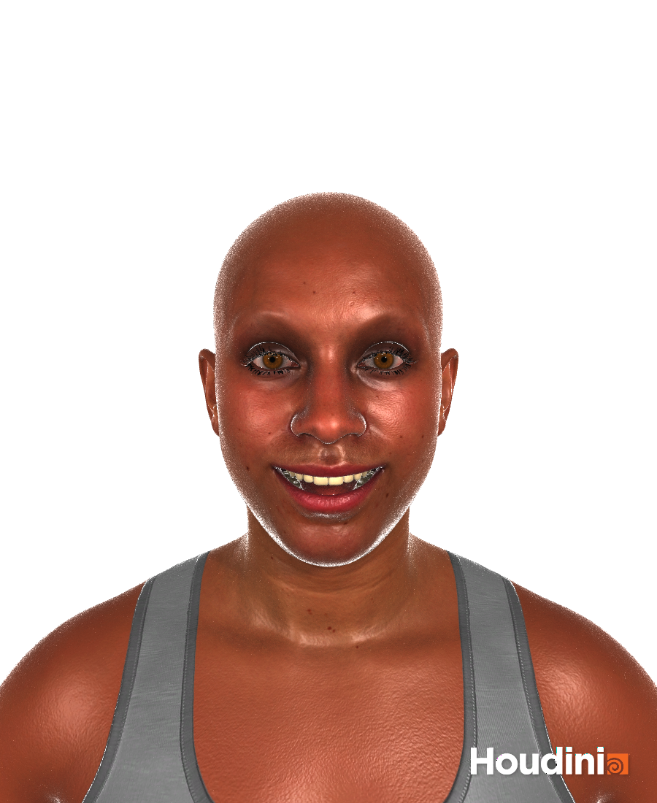

# houdini-dna-rig-mac

Unofficial macOS (Apple Silicon) build of the two native components of Epic Games' **MetaHuman for Houdini**
plugin, so a MetaHuman DCC export can be imported, posed and animated in Houdini on a Mac.

Not affiliated with or endorsed by Epic Games. MetaHuman, RigLogic and Unreal Engine are trademarks of Epic Games, Inc.



## Why

MetaHuman for Houdini 1.3.2 ships its HDAs for every platform, but two compiled parts only for Linux and
Windows. On a Mac the character import fails and the rig doesn't move. This project rewrites those two parts
with Houdini's HDK and Epic's open-source [OpenRigLogic](https://github.com/EpicGames/openriglogic) (MIT):

| File | Replaces | Does |
|---|---|---|
| `metahuman_dna_import.dylib` | SOP `mhdna_import` | reads head/body DNA: meshes, UVs, normals, skeleton, skin weights, blend shapes, RigLogic metadata |
| `metahuman_rig_logic.dylib` | APEX `mh::RigLogic`, `mh::DrivenKeys` | face board → RigLogic → joints, blend shapes and wrinkle maps; body RBF correctives |

Everything else (Character Rig, face board, materials) is Epic's plugin, which you download yourself.
This repository contains none of Epic's plugin files.

## Requirements

- Apple Silicon Mac, Houdini 22.0 (tested with 22.0.466; Apprentice works)
- MetaHuman for Houdini 1.3.2 (character assembler 1.2.11) from Epic — see
  [Installing in Houdini](https://dev.epicgames.com/documentation/en-us/metahuman/installing-in-houdini)
  for where to get it
- A MetaHuman DCC export from Unreal Engine 5.6+ (the folder with `head.dna`, `body.dna`, `Maps/`, `Masks/`)

## Install

1. Download the zip from [Releases](../../releases) and unzip it.
2. Unzip Epic's MetaHuman for Houdini download anywhere. Don't install its `MetaHumanForHoudini.json`
   package file — it points Houdini at the Linux/Windows builds.
3. Run, then restart Houdini:
   ```bash
   ./install.sh /path/to/MetaHumanForHoudini
   ```

`install.sh` copies the plugin's cross-platform files into `package/` next to the dylibs, adds the dylibs,
clears the download quarantine flag and registers the package in
`~/Library/Preferences/houdini/22.0/packages/houdini_dna_rig_mac.json`. To uninstall, delete that file.

### Build from source

Needs the Xcode command line tools and Houdini 22.0.

```bash
git clone --recursive https://github.com/weijkw0/houdini-dna-rig-mac.git
cd houdini-dna-rig-mac
./build.sh /path/to/MetaHumanForHoudini
```

`build.sh` compiles OpenRigLogic (pinned submodule, v13.2.9 = UE 5.8.3) and the two dylibs into `build/bin/`,
then runs `install.sh`. Set `HFS` if Houdini isn't in `/Applications/Houdini/Houdini22.0.*`.

## Use

In a Geometry network: **MetaHuman Character Rig** (set *MetaHuman Folder* to the DCC export) →
**APEX Scene Add Character** → **APEX Scene Animate**. Select Scene Animate, press Enter in the viewport and
drag the face board or FK controls. `tests/build_demo.py` builds this network:

```bash
hython tests/build_demo.py /path/to/DCCExport/NewMetaHumanCharacter demo.hipnc
```

## Verification

The results were checked against references that don't share this code:

| Check | Reference | Result |
|---|---|---|
| 10 meshes, UVs, normals, 858 blend shapes | DNA read by OpenRigLogic's Python bindings | counts match, sampled positions ≤ 0.001 mm |
| 1185 joint positions | Blender's Character DNA importer | ≤ 0.0036 mm |
| Skin weights, rest-pose Bone Deform | rest mesh | weights sum to 1, ≤ 0.0005 mm |
| Face joints (5 face-board poses) | OpenRigLogic Python bindings, same DNA | ≤ 0.0002 mm |
| Blend shape and wrinkle-map weights | same | exact |
| Body RBF correctives (4 poses) | same | translation ≤ 0.0001 mm, rotation ≤ 6e-7 |

Also tested: a second DCC export, LOD 1, units multiplier ×100, and live evaluation in the Houdini UI.

To rerun, generate the expectations from your own export with OpenRigLogic's Python bindings (built from the
submodule, or the macOS build bundled with Blender's Character DNA add-on), then run the oracles in hython:

```bash
export MH_CHARACTER=/path/to/DCCExport/NewMetaHumanCharacter
python3 -I tests/dna_expect.py <bindings_dir> $MH_CHARACTER tests/expect_dna.json
python3 -I tests/riglogic_expect.py <bindings_dir> $MH_CHARACTER/head.dna tests/expect_riglogic.json
python3 -I tests/riglogic_body_expect.py <bindings_dir> $MH_CHARACTER/body.dna tests/expect_riglogic_body.json
hython tests/oracle_b1.py     # importer, 7 gates
hython tests/oracle_b2.py     # RigLogic, 5 gates
hython tests/smoke_extra.py   # LOD 1, units x100 (+ $MH_CHARACTER2 if set)
```

`python3` must be the Python version the bindings were built for. The Blender joint cross-check
(`tests/expect_blender_joints.json`) is optional.

## Limitations

- Houdini 22.0 on Apple Silicon only; other 22.0.x builds than 22.0.466 are untested.
- Not tested: the animation import/export HDAs, LOD 2 and above.
- Not included: Epic's groom tools and the MetaHuman main menu. Hair and clothing aren't part of the DCC export.

How the components are wired and how RigLogic has to be built is in [docs/INTERFACE.md](docs/INTERFACE.md).

## License

This repository's code is MIT ([LICENSE](LICENSE)). OpenRigLogic is MIT, © Epic Games, Inc.
([THIRD_PARTY_NOTICES.md](THIRD_PARTY_NOTICES.md)). MetaHuman for Houdini isn't included and is under Epic's license.

## 中文说明

Epic 官方的 MetaHuman for Houdini 只提供 Linux/Windows 的编译件，Mac 上导入角色会失败、绑定也不会动。
本项目用 Houdini HDK 和 Epic 开源的 OpenRigLogic 重写了这两个编译件。官方插件请自行从 Epic 下载，解压后运行
`./install.sh 官方插件目录`，重启 Houdini 即可。卸载：删除
`~/Library/Preferences/houdini/22.0/packages/houdini_dna_rig_mac.json`。本项目为非官方作品，与 Epic Games 无关。
